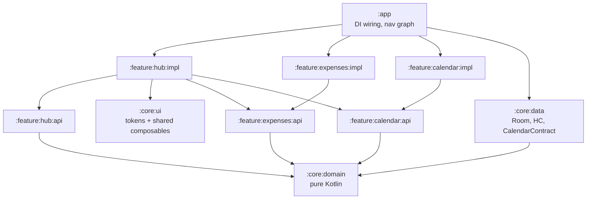

# SafeSpace

A diary that writes itself: spending, calendar, and health in one timeline. **On-device only.**

> **Portfolio project.** Real data sources (bank notifications, Health Connect, system calendar) are implemented in the `debug` build; the `demo` build ships with sample data so you can see the app without granting any permissions.

## Screenshots

| Today — rich day | Scroll to tomorrow | Nested expense under event |
|---|---|---|
| `docs/screenshots/hub-today.png` | `docs/screenshots/hub-scroll.gif` | `docs/screenshots/hub-nested.png` |

_Captured from the `demo` build at the frozen moment of 15:40._

## Try it

```bash
# fastest path: no permissions, no accounts, no network
./gradlew :app:installDemo
```

Or grab the signed `demo` APK from the [Releases](../../releases) page and sideload it.

- **`demo` build** — fakes behind the same domain interfaces, FAB adds a real expense to the in-memory feed, "Yes" on the Netflix question card turns a draft into a timeline row.
- **`debug` build** — real `CalendarContract`, Health Connect, and `NotificationListenerService`. Needs a physical device for notifications and Health Connect; emulators don't deliver either.

## Architecture



Direction of dependencies: `feature → domain ← data`. The hub reads other features through their `:api` contracts, never their `:impl`. `:core:domain` is pure Kotlin — zero Android imports, so business logic is KMP-ready and testable without a device.

## Decisions worth discussing

Taken straight from the code, not from a wish list.

1. **"Now" is a render property, not data.** `TimelineMapper` has no clock; `rememberNow()` ticks once per minute (aligned to the minute boundary) and the UI computes `isFuture = instanceStart > now` locally. Keeps the mapper pure and testable; makes the demo clock trivially overridable.
2. **Injected `Clock` → `DemoClock`.** `Clock` is a Koin `single` (`Clock.System` in `debug`/`release`, `DemoClock` in `demo` with a 15:40 anchor plus real elapsed time). The ViewModel takes a `Clock`; Compose reads it from `LocalAppClock`. No part of the feature code knows which build it's in.
3. **Demo mode via Koin override, not `if (DEMO)` branches.** `app/src/debug|release|demo/.../koin/BuildTypeKoinModules.kt` is a per-sourceSet file with the same signature; `demo` returns `listOf(demoDataModule)`, which overrides the data repositories. Features never see a `DEMO` flag.
4. **`HealthState` is sealed, not an enum.** `HealthState = NotInstalled | NoPermission(toRequest) | Available(data)` — only one state carries data, so "no permission but with a reading" is unrepresentable.
5. **Timeline is a `sealed interface TimelineNode`.** `Leaf(item)` and `EventWithExpenses(event, nested)` — the mapper decides nesting (linked `eventId` wins; otherwise windowed overlap; all-day events are excluded; inner-most event wins for overlaps). No aggregates, no "usually ~$80" — product rule, not a limitation.
6. **Chronology is sacred.** The feed is sorted by `sortKey` end-to-end. Spacing is a pure function of neighbors (`gapBefore(prev, cur)`): 6dp inside a genre, 16dp across genres, 14dp around NowLine and QuestionCards. Genre never beats time.
7. **Product laws encoded in the UI.** No streaks, no red numbers, no counters of missed items. A lonely number without a pair is treated as a judgement — so the day header shows no running expense total; event rows carry their own duration instead of a global "spent so far."
8. **Money is `Long` minor units.** `Double` is not allowed to touch currency anywhere in the data layer.
9. **Idempotent background work.** `WorkManager` tasks check persisted status before firing — reboots and retries can't double-confirm.
10. **Hand-written Room migrations.** `MigrationTestHelper` covers each migration; `fallbackToDestructiveMigration` is off. User data never gets dropped on a schema bump.

## Tech stack

Kotlin 2.2 · Jetpack Compose (Material 3) · Coroutines & Flow · Room 2.7 · Koin 3.5 · Health Connect 1.1 · `CalendarContract` · WorkManager · Navigation Compose (type-safe `@Serializable`) · `kotlinx-datetime` · JUnit + Turbine · AGP 9.2 + KSP.

## Build

```bash
./gradlew assembleDebug        # real data sources
./gradlew assembleDemo         # fake data, no permissions required
./gradlew test                 # JVM unit tests
./gradlew connectedDebugAndroidTest   # Room migration + instrumented tests
```

## Privacy

Everything stays on-device. No backend, no account, no telemetry. The local Room database is the only store, and the `demo` build keeps its data in memory for the lifetime of the process.

## Status

Portfolio project. Real integrations (bank notifications, Health Connect, calendar) ship in the `debug` build; the `demo` build is the fastest way to see what the app feels like.

## License

[MIT](LICENSE)
